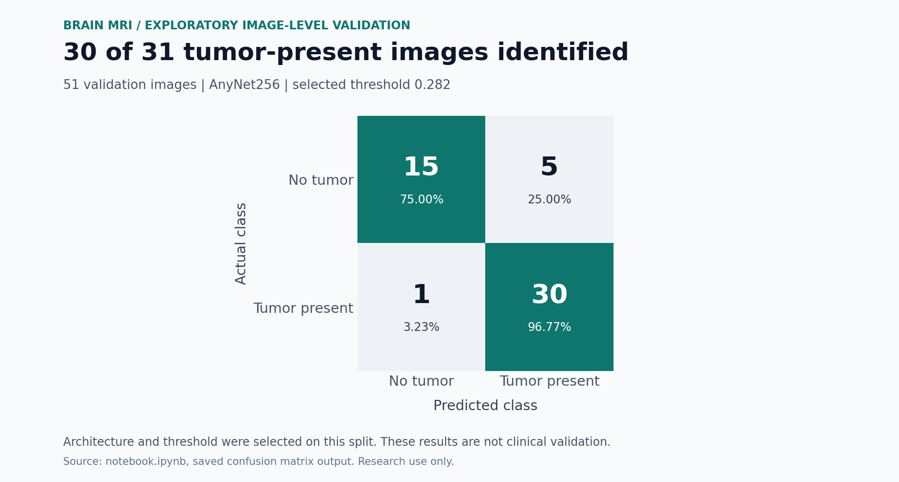
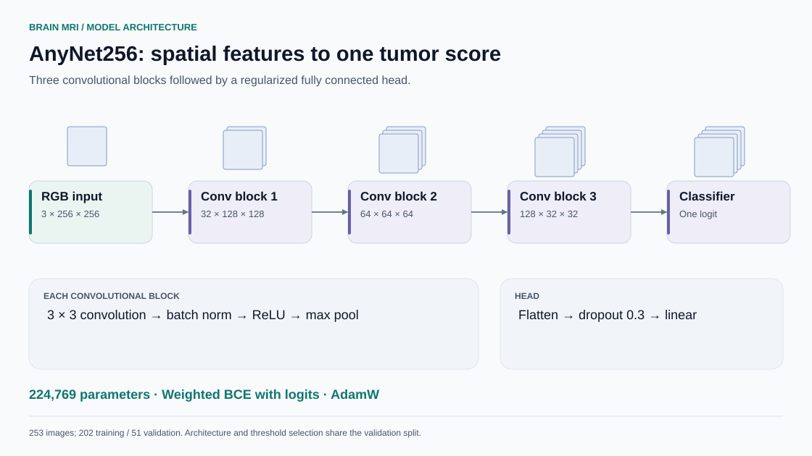
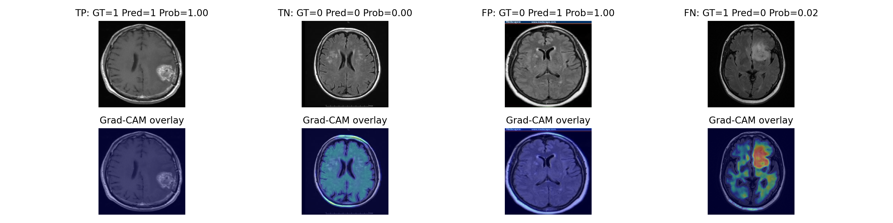

# Brain MRI Classification

Binary classification of tumor-present and no-tumor brain MRI images using custom PyTorch convolutional networks, threshold analysis, and Grad-CAM.

The notebook compares several compact CNN heads and a 256 × 256 input configuration. Evaluation connects aggregate scores to individual correct and incorrect predictions.

## Recorded validation

The dataset contains **253 images**. A stratified split with seed 42 assigns 202 images to training and 51 to validation.

| Split | No-tumor | Tumor-present | Total |
| --- | ---: | ---: | ---: |
| Training | 78 | 124 | 202 |
| Validation | 20 | 31 | 51 |

At the validation-selected threshold of **0.282**, the recorded AnyNet256 run produces:

| Metric | Result |
| --- | ---: |
| Tumor recall | 30 / 31, or 96.8% |
| Tumor precision | 30 / 35, or 85.7% |
| Accuracy | 45 / 51, or 88.2% |
| Average precision | 0.960 |
| ROC-AUC | 0.937 |
| False positives / false negatives | 5 / 1 |

Architecture comparison and threshold selection use the same validation split. These are exploratory image-level validation results, not independent clinical performance. This model is not intended for diagnosis.

## AnyNet256

| Stage | Operation | Output per image |
| --- | --- | --- |
| Input | Resize and normalize RGB image | 3 × 256 × 256 |
| Block 1 | 3 × 3 convolution, batch norm, ReLU, max pool | 32 × 128 × 128 |
| Block 2 | 3 × 3 convolution, batch norm, ReLU, max pool | 64 × 64 × 64 |
| Block 3 | 3 × 3 convolution, batch norm, ReLU, max pool | 128 × 32 × 32 |
| Head | Flatten, dropout 0.3, linear layer | One logit |

The implementation has **224,769 parameters**. Training uses weighted binary cross-entropy with logits and AdamW. Horizontal flips and small rotations are applied only to training images. The 256-pixel experiment reuses the original split indices.

## Inspect predictions

Grad-CAM uses the final convolutional layer to visualize image regions contributing to the tumor score. The recorded gallery includes a true positive, true negative, false positive, and false negative.

Activation maps support model inspection; they are not lesion segmentations or clinical explanations.

[Precision-recall curve](figs/pr_curve_20250926_131053.png) · [ROC curve](figs/roc_curve_20250926_131053.png)

## Reproduce the notebook

[Open notebook.ipynb](notebook.ipynb). It uses a Colab-style dataset location, `/content/data/brain_tumor_dataset`, with `no/` and `yes/` class folders.

Download [Brain MRI Images for Brain Tumor Detection](https://www.kaggle.com/datasets/navoneel/brain-mri-images-for-brain-tumor-detection) and prepare that directory. The notebook uses PyTorch, torchvision, scikit-learn, NumPy, Matplotlib, seaborn, and scikit-image.

Run the notebook in order. The saved evaluation uses the model state from that run; the notebook also saves `best_model256.pth` during training.
